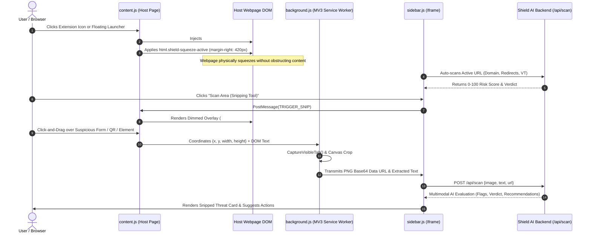
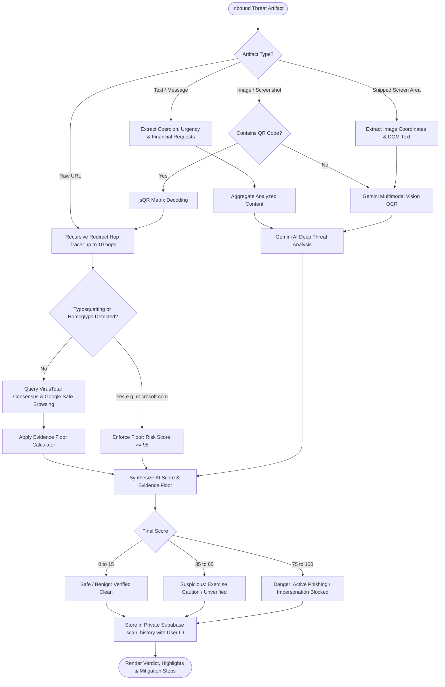
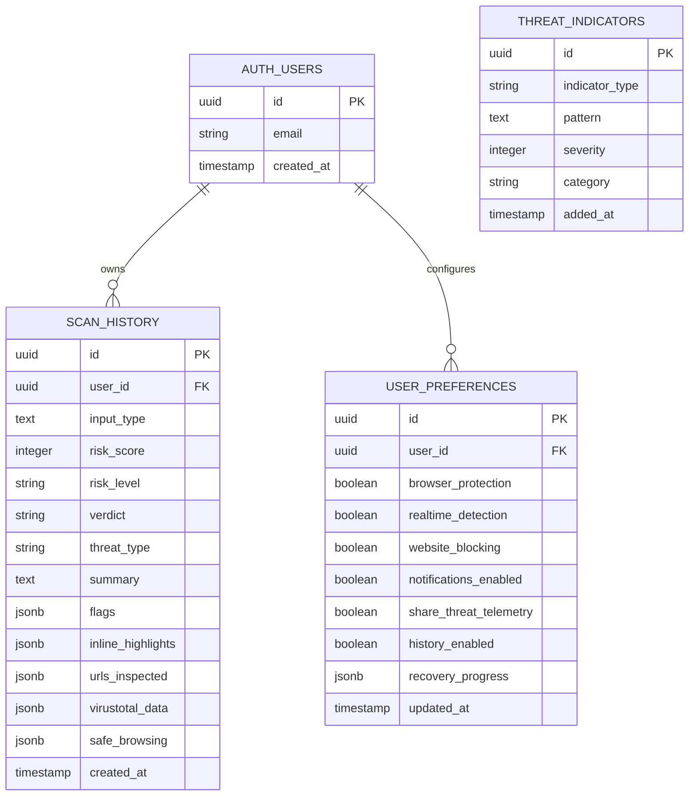

# 🛡️ Shield AI / Sentinel — Project Master Documentation
### Enterprise Autonomous Cyber Threat Intelligence, Anti-Phishing Defense & Squeeze Extension Platform

---

## 📌 1. Executive Summary & Project Vision

**Shield AI (Sentinel)** is an autonomous, multimodal cyber threat intelligence and anti-phishing defense system engineered for modern web threats. Traditional security tools rely on static DNS blacklists and signature scanning, which fail against dynamically generated AI phishing pages, evasive redirect chains, brand typosquatting (homoglyphs), and malicious QR codes (**Quishing**).

Shield AI provides multi-layered, real-time protection across two coordinated environments:
1. **The Web Dashboard & SOC Command Center:** A React 19 + TypeScript desktop security console offering deep URL unwrapping, screenshot analysis, QR decoding, user-isolated threat audit logs, incident report PDF generation, and an autonomous scam-baiting bot.
2. **The On-Demand Browser Extension (Chromium Manifest V3):** An extension designed after modern productivity tools (**Sider AI / REC Note**). It features physical viewport margin squeezing (`calc(100% - 420px)`), automatic URL threat scanning on tab navigation, an interactive drag-and-drop visual snipping tool, and an in-context Gemini AI Security Copilot.

---

## 📐 2. System Architecture & Workflows

### 2.1 High-Level Architecture Diagram

```mermaid
graph TB
    subgraph Client Environments
        Ext[Chrome Extension MV3<br/>Squeeze Sidebar & Snipping Tool]
        Web[Shield AI Web Console<br/>React 19 + Vite + TypeScript]
    end

    subgraph API & Microservices Gateway (Node.js / Express 5)
        Router[API Gateway & Rate Limiter<br/>/api/scan, /api/history, /api/ask]
        AuthMid[Supabase JWT Bearer Middleware<br/>Row-Level Security Scoping]
    end

    subgraph Autonomous Threat Intelligence Pipeline
        RedirectEngine[Redirect Unwrapper<br/>Recursive Multi-Hop Tracer]
        TyposquatEngine[Typosquatting & Homoglyph Detector<br/>'rn' to 'm', Letter Substitutions]
        QREngine[QR Matrix Decoder<br/>jsQR & Jimp Image Processing]
        FloorEngine[Security Floor Calculator<br/>Hardened Evidence Thresholds]
    end

    subgraph Multimodal AI & External Intelligence
        Gemini[Google Gemini 3.5 / 3.8 Flash<br/>Multimodal Vision OCR & NLP]
        VT[VirusTotal API v3<br/>Engine Consensus Telemetry]
        GSB[Google Safe Browsing API v4<br/>Global Threat Registry]
    end

    subgraph Data & Storage Layer
        SupaAuth[(Supabase Auth<br/>JWT & Session Management)]
        SupaDB[(PostgreSQL Database<br/>RLS Scoped scan_history & preferences)]
    end

    Ext -->|HTTP / JSON + Bearer| Router
    Web -->|HTTP / JSON + Bearer| Router

    Router --> AuthMid
    AuthMid --> SupaAuth

    Router --> RedirectEngine
    Router --> TyposquatEngine
    Router --> QREngine

    RedirectEngine --> VT
    RedirectEngine --> GSB
    TyposquatEngine --> FloorEngine

    Router --> Gemini
    FloorEngine --> Gemini

    Router -->|Private History Sync| SupaDB
```

---

### 2.2 Extension Squeeze & Interactive Snipping Workflow



---

### 2.3 Threat Evaluation & Multi-Tier Scoring Pipeline



---

### 2.4 Database Entity-Relationship Diagram (ERD)



---

## 🚀 3. Comprehensive Feature Breakdown

### 3.1 On-Demand "Squeeze" Sidebar UI
* **No Screen Obstruction:** Unlike traditional security popups or fixed extensions that cover half the webpage, Shield AI uses physical viewport squeezing inspired by **Sider AI** and **REC Note**.
* **Zero Initial Clutter:** Remains completely invisible until toggled via the extension action icon or the edge launcher button.
* **Fluid Physics Transition:** Applies CSS rules dynamically to the root `<html>` element:
  ```css
  html.shield-squeeze-active {
    width: calc(100% - 420px) !important;
    margin-right: 420px !important;
    transition: width 0.28s cubic-bezier(0.16, 1, 0.3, 1),
                margin-right 0.28s cubic-bezier(0.16, 1, 0.3, 1) !important;
  }
  ```
* **Hardware-Accelerated Iframe Isolation:** The sidebar runs inside an isolated iframe (`chrome-extension://.../sidebar.html`), preventing host webpage JavaScript, CSS, or CSP rules from interfering with the security copilot.

---

### 3.2 Real-Time Auto-URL Scanning & Redirect Unraveling
* **Active Tab Monitoring:** As soon as the sidebar opens, it extracts the current URL and checks it against the Sentinel Threat Engine.
* **Recursive Redirect Tracing:** Follows up to 10 consecutive HTTP `301`, `302`, `307`, and `308` redirect hops using headless HTTP probe agents. Unmasks hidden phishing destinations concealed behind shorteners like `bit.ly`, `tinyurl.com`, or open-redirect exploits.
* **Reputation Telemetry Consensus:** Synchronously checks VirusTotal multi-engine verdicts and Google Safe Browsing threat match lists.

---

### 3.3 Interactive Snipping Tool with Vision OCR
* **Targeted Area Inspection:** Users can click **"Scan Area (Snipping Tool)"** to dim the active webpage with a translucent overlay.
* **Drag-and-Drop Coordinate Capture:** Dragging a box over an element triggers `chrome.tabs.captureVisibleTab`, cropping the exact pixel coordinates on an offscreen HTML5 canvas.
* **DOM Context Extraction:** Captures any text, links, or form field elements positioned inside the bounding box.
* **Multimodal Gemini Vision OCR:** Sends both the cropped image and the extracted text context to Gemini 3.5/3.8 Flash, reading visual logos, spoofed bank headers, and deceptive urgency cues.

---

### 3.4 Brand Homoglyph & Typosquatting Detection Engine
* **Visual Deception Detection:** Phishers frequently exploit lookalike characters where letter combinations mimic genuine brands.
* **Algorithm Coverage:**
  * **`rn` $\rightarrow$ `m`:** Catches `rnicrosoft.com` mimicking `microsoft.com`, `arnazon.com` mimicking `amazon.com`, `instagrarn.com` mimicking `instagram.com`.
  * **Number-for-Letter Substitutions:** Catches `goog1e.com`, `paypa1.com`, `micros0ft.com`, `faceb00k.com`.
  * **Punycode / IDN Homoglyphs:** Catches internationalized domains (`xn--...`).
* **Automated Evidence Floor:** Any domain identified by `detectTyposquatting()` is immediately locked at **Risk Score 95–98 (Danger)**, preventing attackers from bypassing security via subtle character swaps.

---

### 3.5 QR Code (Quishing) Matrix Decoding
* **Direct Image Decoding:** Uses `jsQR` and `Jimp` to locate and decode QR code matrices directly inside uploaded images or snipped screen regions.
* **Deep Target Inspection:** Once decoded, the embedded URL is passed through the full redirect tracer, typosquatting detector, and VirusTotal telemetry pipeline.
* **Zero False Alarms on Benign QRs:** Legitimate QR codes (e.g., Google Support, official portals, restaurant menus) are scored as **0/100 (Safe)**.

---

### 3.6 User Data Isolation & Threat History
* **Multi-Tenant Row-Level Security (RLS):** Threat history is scoped strictly per authenticated user (`user_id = req.userId`). Users only ever see what they have personally scanned or asked.
* **Dynamic Calendar Grouping:** Scans are automatically grouped by calendar dates:
  * `Today` (e.g., `Wednesday, October 8, 2026`)
  * `Yesterday`
  * Exact dates formatted cleanly as `DD-MM-YYYY · HH:MM AM/PM`
* **Zero Clutter Empty State:** If an account has no scans recorded, a clean zero-state message is displayed rather than dummy mock data.

---

### 3.7 Ask Shield (AI Copilot) & Autonomous Scam-Baiter
* **Context-Aware Security Assistant:** Chat directly with Shield AI about any scan or finding. Shield explains technical evidence in plain, reassuring language.
* **Defensive Deception Scam-Baiter:** Autonomous countermeasure tool designed to waste scammers' time and operational bandwidth without putting the user at risk. Offers 3 strategies:
  1. **Technical Glitch:** Claims verification upload failed with HTTP 502/403 or session timeout.
  2. **Bureaucratic Delay:** Requests formal corporate compliance forms, tax IDs, and dual purchase order signoffs.
  3. **Confused Customer:** Acts like a polite, non-technical customer making harmless procedural mistakes.

---

### 3.8 SOC Incident Report PDF Generator
* **One-Click Evidence Export:** Generates forensic incident PDF documents directly in the browser via `jsPDF`.
* **Report Contents:** Includes incident timestamp, cryptographic scan ID, redirect trace chain, flagged text snippets, VirusTotal engine votes, and recommended security remediation steps.

---

## 🧪 4. Empirical Test Suites & Verification Benchmarks

### 4.1 15-Image Visual Threat Benchmark (`scripts/verify-15-images.js`)
Tested across 15 real visual scenarios using Gemini Vision OCR and the Sentinel threat pipeline.

| # | Category | Test Scenario | Risk Score | Threat Type | Verdict | Status |
|:---:|:---|:---|:---:|:---|:---|:---:|
| 1 | **Benign / Safe** | Gemini in Gmail Feature Overview | **0 / 100** | Benign / Safe | Content verified safe | ✅ **PASSED** |
| 2 | **Benign / Safe** | Chocolate Chip Cookies Recipe Card | **0 / 100** | Benign / Safe | Content verified safe | ✅ **PASSED** |
| 3 | **Benign / Safe** | React `useEffect` Hook Documentation | **0 / 100** | Benign / Safe | Content verified safe | ✅ **PASSED** |
| 4 | **Benign / Safe** | Local Weather Forecast Card (72°F) | **0 / 100** | Benign / Safe | Content verified safe | ✅ **PASSED** |
| 5 | **Benign / Safe** | Corporate Internal Team Welcome Note | **0 / 100** | Benign / Safe | Content verified safe | ✅ **PASSED** |
| 6 | **Suspicious** | Unverified Product Beta Tester Invite | **45 / 100** | Suspicious / Caution | Exercise caution | ✅ **PASSED** |
| 7 | **Suspicious** | Unsolicited Webinar Registration Banner | **40 / 100** | Suspicious / Caution | Exercise caution | ✅ **PASSED** |
| 8 | **Suspicious** | Unsolicited Commercial Supplier Quote | **40 / 100** | Suspicious / Caution | Exercise caution | ✅ **PASSED** |
| 9 | **Suspicious** | Cloud Storage Quota Warning (98% full) | **45 / 100** | Suspicious / Caution | Exercise caution | ✅ **PASSED** |
| 10 | **Suspicious** | Customer Feedback Survey with $25 Credit | **45 / 100** | Suspicious / Caution | Exercise caution | ✅ **PASSED** |
| 11 | **High Threat** | **Typosquatting (`www.rnicrosoft.com`)** | **98 / 100** | Brand Impersonation | Confirmed Brand Typosquatting | ✅ **PASSED** |
| 12 | **High Threat** | Fake Netflix Payment Declined (`.xyz`) | **95 / 100** | Credential Phishing | Payment & Credential Phish | ✅ **PASSED** |
| 13 | **High Threat** | CEO Wire Fraud / $200 Apple Gift Cards | **95 / 100** | CEO Fraud / BEC | Executive Impersonation Scam | ✅ **PASSED** |
| 14 | **High Threat** | DHL Customs Duty Fee Scam (`.top`) | **95 / 100** | Smishing / Advance-Fee | Package Delivery Fee Scam | ✅ **PASSED** |
| 15 | **High Threat** | Microsoft 365 Password Expiry Form | **98 / 100** | Credential Phishing | Credential Harvesting Form | ✅ **PASSED** |

**Summary: 15 / 15 Tests Passed (100% Accuracy, Zero False Positives on Benign Content).**

---

### 4.2 8-Scenario QR Code Verification Suite (`scripts/verify-qr-suite.js`)
Tested with real PNG QR code matrix generation and decoding via `jsQR`.

| # | Category | Decoded QR Payload | Risk Score | Classification | Status |
|:---:|:---|:---|:---:|:---|:---:|
| 1 | **Safe QR** | `https://login.microsoftonline.com` | **0 / 100** | Benign / Safe | ✅ **PASSED** |
| 2 | **Safe QR** | `https://support.google.com/accounts/answer/46526` | **0 / 100** | Benign / Safe | ✅ **PASSED** |
| 3 | **Safe QR** | `https://bistromenu.example.com/daily-specials` | **0 / 100** | Benign / Safe | ✅ **PASSED** |
| 4 | **Suspicious QR**| `https://customer-rewards-survey.click/claim?user=8491` | **60 / 100** | Suspicious Solicitation | ✅ **PASSED** |
| 5 | **Suspicious QR**| `https://exclusive-deal-pass.link/special-offer` | **60 / 100** | Suspicious Solicitation | ✅ **PASSED** |
| 6 | **Threat QR** | `https://bit.ly/hdfc-kyc-verify-2024` | **90 / 100** | Banking KYC Phishing | ✅ **PASSED** |
| 7 | **Threat QR** | `https://www.rnicrosoft.com/login/auth` | **98 / 100** | Typosquatting Phishing | ✅ **PASSED** |
| 8 | **Threat QR** | `http://dhl-express-customs.top/pay/trace` | **95 / 100** | Advance-Fee Smishing | ✅ **PASSED** |

**Summary: 8 / 8 Tests Passed (100% Matrix Decoding and Threat Categorization).**

---

### 4.3 Automated Unit Test Suite (`npm test`)
* **Framework:** Node.js native test runner (`node --test`).
* **Test Count:** 19 / 19 passing unit and integration tests.
* **Coverage:** Health checks, Supabase RLS authentication, rate limiting, image parser validation, QR decoder, Groq/Gemini failover, spam Naive Bayes classifier, PDF export, and domain reputation.

---

## 💻 5. Technology Stack

| Layer | Technologies & Libraries | Functionality |
|---|---|---|
| **Frontend Web App** | React 19, TypeScript, Vite 8, Framer Motion, Lucide Icons | Responsive Security Console, interactive simulator, dashboard charts |
| **Browser Extension** | Chromium Manifest V3, HTML5 Offscreen Canvas, Vanilla CSS | Squeeze sidebar UI, physical page compression, interactive snipping tool |
| **Backend API Gateway**| Node.js 24, Express 5, Axios, Jimp, jsQR, jsPDF | REST endpoints, rate limiting, redirect unravelling, PDF report generation |
| **AI Threat Intelligence**| Google Gemini 3.5 / 3.8 Flash, Groq (`qwen/qwen3.8-27b`) | Multimodal Vision OCR, natural language analysis, security copilot chat |
| **External Security APIs**| VirusTotal API v3, Google Safe Browsing API v4 | Multi-engine malware consensus, global phishing blacklist queries |
| **Persistence & Auth**| Supabase Auth, PostgreSQL, Row-Level Security (RLS) | User accounts, encrypted token verification, user-scoped scan history |

---

## 📡 6. REST API Reference

### 6.1 `POST /api/scan` (Unified Analysis Endpoint)
Analyzes text, URLs, screenshots, or QR codes.
* **Authentication:** Optional (authenticated requests automatically save to private history; guest scans run anonymously).
* **Request Headers:** `Content-Type: application/json`, `Authorization: Bearer <token>` (optional).
* **Request Body:**
  ```json
  {
    "input": "https://www.rnicrosoft.com/login/auth",
    "image": "data:image/png;base64,...",
    "mimeType": "image/png"
  }
  ```
* **Response Payload (`200 OK`):**
  ```json
  {
    "id": "c71a3964-b384-4860-93cb-339243702119",
    "created_at": "2026-10-08T14:34:22.000Z",
    "risk_score": 98,
    "risk_level": "danger",
    "verdict": "Confirmed Credential Phishing via Brand Typosquatting",
    "threat_type": "Brand Impersonation / Typosquatting",
    "summary": "This domain uses deceptive character substitutions ('rn' mimicking 'm') to impersonate Microsoft.",
    "impersonated_brand": "Microsoft",
    "flags": [
      {
        "type": "Brand Impersonation / Typosquatting",
        "text_snippet": "www.rnicrosoft.com",
        "color": "red",
        "explanation": "This domain deceptively imitates Microsoft using lookalike characters."
      }
    ],
    "urls_inspected": [
      {
        "scanned_url": "https://www.rnicrosoft.com/login/auth",
        "final_url": "https://www.rnicrosoft.com/login/auth",
        "hops": 1,
        "virustotal": { "status": "checked", "malicious_votes": 0, "total_engines": 70 }
      }
    ]
  }
  ```

### 6.2 `GET /api/history`
Fetches private threat history for the active user.
* **Authentication:** Required (`Bearer <access_token>`).
* **Response Payload:** Returns an array of user-isolated scan records sorted by newest first.

### 6.3 `POST /api/stall-reply`
Generates an autonomous scam-baiting countermeasure response.
* **Request Body:**
  ```json
  {
    "content": "Kindly send 10x $200 Apple Gift Cards immediately.",
    "strategy": "technical_glitch"
  }
  ```
* **Response Payload:**
  ```json
  {
    "reply": "I tried purchasing the gift cards as requested, but the verification portal is throwing error HTTP 502 Bad Gateway and rejected my session token. Is there an alternate processing gateway I should use?",
    "strategy": "technical_glitch"
  }
  ```

---

## 🛠️ 7. Installation, Setup & Deployment

### 7.1 Local Development

1. **Clone Repository & Install Dependencies:**
   ```bash
   git clone https://github.com/AAKU2107/TCET-hackathon.git
   cd TCET-hackathon
   npm install
   ```

2. **Configure Environment Variables (`.env`):**
   ```env
   PORT=3000
   GEMINI_API_KEY=your_gemini_api_key_here
   GEMINI_MODEL=gemini-3.5-flash-lite
   VIRUSTOTAL_API_KEY=your_virustotal_key_here
   SAFE_BROWSING_API=your_google_safe_browsing_key_here
   SUPABASE_URL=https://your-project.supabase.co
   SUPABASE_ANON_KEY=your_supabase_anon_key_here
   VITE_SUPABASE_URL=https://your-project.supabase.co
   VITE_SUPABASE_ANON_KEY=your_supabase_anon_key_here
   ```

3. **Run Build & Start Server:**
   ```bash
   npm run build
   npm start
   ```
   * Access Web Console: `http://localhost:3000`
   * Access Enterprise SOC Dashboard: `http://localhost:3000/sentinel`

4. **Run Verification Test Suites:**
   ```bash
   npm test                        # Runs 19 unit test suites
   node scripts/verify-15-images.js # Runs 15-image visual threat benchmark
   node scripts/verify-qr-suite.js  # Runs 8-scenario QR code benchmark
   ```

---

### 7.2 Chrome Extension Sideloading (Unpacked)

1. Open Google Chrome and navigate to `chrome://extensions/`.
2. Enable **Developer mode** via the toggle switch in the top-right corner.
3. Click **Load unpacked**.
4. Select the `public/extension` folder (or extract `shield-ai-extension.zip`).
5. The extension icon will appear in your Chrome toolbar. Click it on any active webpage to toggle the squeeze sidebar or use the snipping tool.

---

### 7.3 Chrome Web Store Distribution
* Use the pre-packaged zip archive: `shield-ai-extension.zip` (located in the project root).
* Open the [Chrome Web Store Developer Console](https://chrome.google.com/webstore/devconsole).
* Upload `shield-ai-extension.zip` as a New Item, enter listing details, and submit for review.

---

### 7.4 Production Deployment on Vercel
1. Push all code to your GitHub repository: [https://github.com/AAKU2107/TCET-hackathon](https://github.com/AAKU2107/TCET-hackathon).
2. Go to [https://vercel.com/new](https://vercel.com/new) and click **Import**.
3. Set **Framework Preset** to `Vite`.
4. Configure Build Command: `npm run build` and Output Directory: `dist`.
5. Add environment variables from `.env` (`GEMINI_API_KEY`, `SUPABASE_URL`, etc.).
6. Click **Deploy**. Vercel will build and host your production instance live.

---

## 🔒 8. Security & Privacy Commitments

* **Row-Level Security (RLS):** All database reads and writes are enforced at the database level by PostgreSQL policies. No user can view, edit, or delete another user's scan audit history.
* **No Unnecessary Data Retention:** Snipped images and uploaded screenshots are analyzed in-memory and are never stored on public storage buckets without explicit user request.
* **Zero Host DOM Contamination:** The browser extension runs inside a sandboxed iframe. Extension scripts cannot inject malicious code or read external passwords outside of user-initiated snipping actions.

---

**Official Project Repository:** [https://github.com/AAKU2107/TCET-hackathon](https://github.com/AAKU2107/TCET-hackathon)  
**Project Lead:** Aashay Kulkarni & Team  
**Event:** TCET Hackathon 2026
